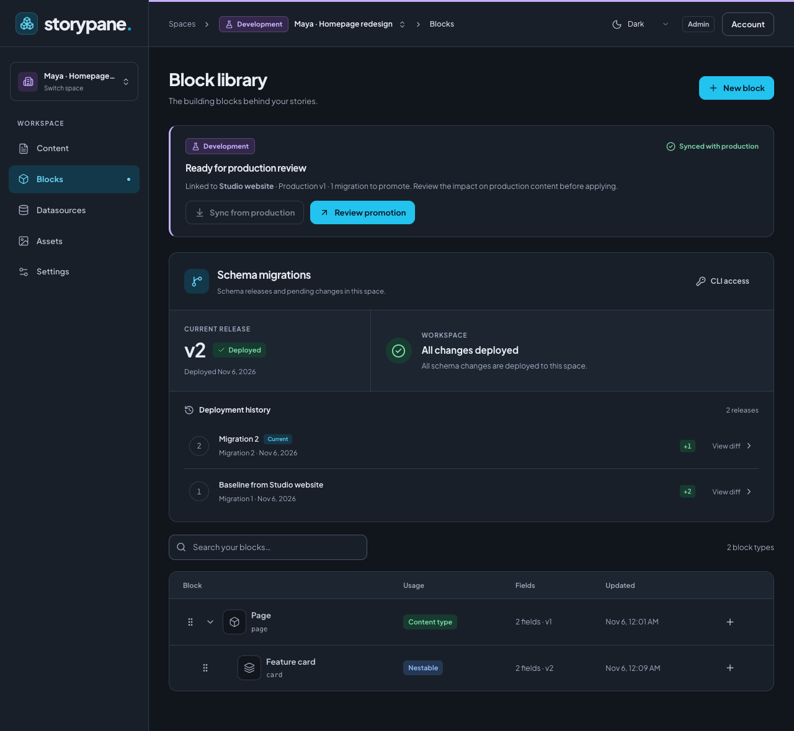

# Storypane

**A collaborative, open-source CMS for the websites you build.**

**0.1.0-rc.2 — release candidate.** [Release status and known limits](docs/releases-and-versioning.md).

Give editors a place to compose pages, preview changes, and publish together.
Keep your frontend, your components, and your content on infrastructure you control.

[Website](https://storypane.dev) · [Documentation](docs/README.md) ·
[Get started](#get-started) · [SDK](packages/sdk/README.md) · [MIT license](LICENSE)

## Content you can work on together

Storypane is a headless CMS built around structured blocks. Developers define
content types and render them in their own applications; editors assemble pages
and see their changes in a live website preview.

- **Edit together.** Work on different blocks of the same page at the same time,
  with presence indicators, automatic saving, and block locks that prevent
  conflicting edits.
- **Preview in your website.** Use your own components for live draft previews,
  including unpublished pages. Select a block in the preview to edit its fields.
- **Publish deliberately.** Review a fixed checkpoint, publish linked content
  together, or group approved pages into [content releases](docs/releases.md).
  Schedule a launch, keep later edits in drafts, and publish the whole release
  together. History lets you restore earlier content.
- **Make room for every locale.** Give each locale its own page structure and URL.
  Copy content between locales as a starting point without keeping them coupled.
- **Model content that fits.** Combine reusable blocks, rich text, media, links,
  and data sources. Review schema migrations and generate TypeScript types for
  your frontend.
- **Choose your sign-in.** Use built-in Better Auth email/password accounts or
  optional Clerk, with company SSO configured through your Clerk instance. Adapt
  your source for a direct Okta or other identity-provider flow. See
  [authentication](docs/authentication.md) for setup and customization boundaries.
- **Control access.** Organize work into spaces with separate PostgreSQL databases.
  Assign roles and scope reading, editing, and publishing down to individual fields.
- **Manage media in one place.** Upload files with pause and resume, organize
  assets, set image focal points, and see where files are used. Original files
  stay private; public delivery of published media is optional.
- **Connect your workflow.** Fetch published content with the SDK, automate through
  the management API, CLI, and MCP, and trigger builds or integrations with signed
  webhooks.

## Get started

The current CMS runs on **Node.js and Docker**, backed by PostgreSQL and private
S3-compatible storage. The Docker setup includes all three services. Built-in
email/password sign-in is the default; Clerk and SMTP are optional.

You need Git, Docker with Compose, and Node.js 24.22+ within v24 for setup.

### 1. Get the source

```sh
git clone https://github.com/lkuich/storypane.git
cd storypane
node scripts/setup-env.mjs
```

### 2. Configure your installation

The setup command creates ignored `.env.production` with private, generated
credentials for the bundled services. It never prints secrets or overwrites an
existing file. The default address is `http://localhost:3130`. For a remote
installation, set `STORYPANE_APP_URL` to your HTTPS origin and configure a reverse
proxy before inviting users.

Keep the env file, encryption keys, and Docker volumes on upgrades. See the
[self-hosting guide](docs/self-hosting.md) for external databases and storage.

### 3. Start Storypane

```sh
docker compose --env-file .env.production -f compose.node.yaml up --build -d
docker compose --env-file .env.production -f compose.node.yaml exec web \
  node --import tsx scripts/admin.ts bootstrap
```

The bootstrap command prompts for the first administrator's name, email, and
password. Open **[localhost:3130](http://localhost:3130)** and sign in. Set up your
production and development spaces using the team workflow below, then follow the
[editor quickstart](docs/editor-quickstart.md) to define blocks and publish a page.

For an external database or object store, HTTPS, invitations, backups, and upgrades,
follow the [self-hosting guide](docs/self-hosting.md). Existing shared-database
installations should follow the [migration and rollback guide](docs/self-hosting.md#legacy-migration-and-rollback).

## Recommended setup for teams

Create one **Production** space for content editors and a linked **Development**
space for each developer. Leave production's **Schema read-only** setting enabled.
Editors write, preview, and publish in production while developers iterate on
schemas in their own spaces.

1. Create production, then create each dev space with production as its **Base space**.
2. Change blocks in dev, deploy the migration there, and test with sample content.
3. Choose **Review promotion** to inspect the impact on production content and apply
   the reviewed migrations. Block-library parents and nested-block rules travel together.
4. Other developers **Sync from production** before continuing and promoting their work.

Clones do not copy content or media in bulk. Dependencies required by schema
defaults are listed for review; copied stories start unpublished. Tokens, members,
and integrations are configured separately in each space.



The header identifies your environment on every screen. Choose the space name to
switch between linked dev and production spaces. Follow the
[complete team workflow](docs/development-workflow.md) for setup, cloning,
promotion, sync conflicts, and CLI access.

## Bring your frontend

Storypane delivers content as structured data. You own the markup, routing, and
rendering, whether you build a static site or fetch content at request time.

In your **production space**, create a **Published content** token in
**Settings → API & preview**. Use the SDK from your application's server code,
with types generated from production's deployed schema:

```ts
import { createStorypaneClient } from '@storypane/sdk';
import { storypaneMigrationVersion, type StorypaneContentType } from './types/storypane';

const storypane = createStorypaneClient<StorypaneContentType>({
  url: process.env.STORYPANE_URL!,
  spaceId: process.env.STORYPANE_SPACE_ID!,
  token: process.env.STORYPANE_DELIVERY_TOKEN!,
  migrationVersion: storypaneMigrationVersion,
});

const page = await storypane.getStory({ slug: 'home' });
// Render page.content with your components.
```

Omit `locale` to use the space's configured default. For lists, call
`storypane.listStories()` or `storypane.listAllStories()` with no options object.

Published reads return publication snapshots. Draft preview uses a separate,
authenticated connection. Keep delivery and preview tokens on the server; rebuild
or revalidate static pages when content is published.

Install the matching SDK release tarball or build/link it from this workspace
using the [SDK guide](packages/sdk/README.md). npm publication is gated separately;
select an explicit candidate version when it becomes available.

Explore a complete integration:

| Example                                | What it demonstrates                                                 |
| -------------------------------------- | -------------------------------------------------------------------- |
| [Astro](apps/example-astro/README.md)  | Static pages, typed React blocks, and an interactive preview island. |
| [Next.js](apps/example-next/README.md) | App Router, Server Components, and a separate live preview route.    |

Both examples include localized pages, media delivery, generated types, and
click-to-edit preview. Your application can use the SDK without adopting either
example's design or routing.

## Develop from source

Use **Node.js 24.22+ within v24**, **pnpm 12.4.2**, and Docker Compose.

Generate local configuration with the setup command below. This is for changing
the CMS source; schema developers use the linked-space workflow above.

```sh
pnpm install --frozen-lockfile
node scripts/setup-env.mjs --local
pnpm db:start
node --env-file=.env --import tsx scripts/admin.ts migrate
node --env-file=.env --import tsx scripts/admin.ts bootstrap
pnpm dev
```

The editor runs at **http://127.0.0.1:3130**. Set `STORYPANE_APP_URL` to that same
origin in `.env`.

### Repository layout

```text
apps/web              Editor, authentication, HTTP API, and Node server
apps/realtime         Shared collaboration rooms and WebSocket handling
apps/example-astro    Astro integration
apps/example-next     Next.js integration
packages/core         Content contracts and validation
packages/db           Permissions, migrations, history, and publishing
packages/assets       Asset metadata, uploads, and delivery
packages/runtime-node Node adapters for storage, images, rooms, and background jobs
packages/sdk          Delivery, preview, management API, and CLI
packages/ui           Shared UI controls
```

PostgreSQL is authoritative for content, permissions, history, and publications.
The Node server handles HTTP, collaboration sockets, and background jobs in one
process. Run **one application replica** until a shared room transport is available.

### Checks and contributions

[Bug reports](https://github.com/lkuich/storypane/issues) and focused pull requests
are welcome. Include steps to reproduce a bug and tests for changes in behavior.

```sh
pnpm lint
pnpm test
pnpm typecheck
pnpm build
```

Database tests need the dedicated local test database: start the fixture Postgres
with `docker compose -f compose.yaml up -d`, then run `pnpm db:test` before
`pnpm test`. `pnpm db:setup` is a local fixture tool, not an installation command.
Browser tests use `pnpm test:e2e` with the CMS running and Google Chrome installed.
Authenticated suites use `STORYPANE_TEST_ADMIN_STATE` and
`STORYPANE_TEST_EDITOR_STATE` session files. Build any configured example sites
first using their integration guides above. Never commit session files or credentials.

## Documentation

- [Getting started](docs/getting-started.md) — installation and first steps.
- [Team development workflow](docs/development-workflow.md) — production for editors,
  linked dev spaces for developers, reviewed promotion, and sync.
- [Editor quickstart](docs/editor-quickstart.md) — model blocks and publish your first page.
- [Authentication](docs/authentication.md) — local sign-in, invitations, recovery, optional Clerk,
  provider migration, and agent credentials.
- [Self-hosting](docs/self-hosting.md) — configuration, authentication, operations,
  backups, and upgrades.
- [SDK](packages/sdk/README.md) — delivery, live preview, media, and generated types.
- [Management API, CLI, and MCP](docs/management-api.md) — automate content and
  configuration changes.
- [Webhooks](docs/webhooks.md) — signed events, delivery, and retries.
- [Railway](docs/deploy-railway.md) and [Cloudflare](docs/deploy-cloudflare.md) —
  provider-specific setup and current support status.
- [Deployment verification](docs/deployment-verification.md) — recorded checks,
  outstanding verification, and the installation acceptance checklist.

Storypane is under active development. The current CMS targets Node/Docker;
Cloudflare hosting in the guides applies to the separate static website. Fresh
Railway deployment acceptance remains unverified. See the guides above before
planning a hosted installation.

## License

Storypane is [MIT licensed](LICENSE), provided without warranty under its terms.
See [privacy and data handling](docs/privacy.md), [security reporting](SECURITY.md),
[third-party notices](THIRD_PARTY_NOTICES.md), and [release/upgrade policy](docs/releases-and-versioning.md). Self-hosted operators
remain responsible for their installation, providers, and user privacy notices.
