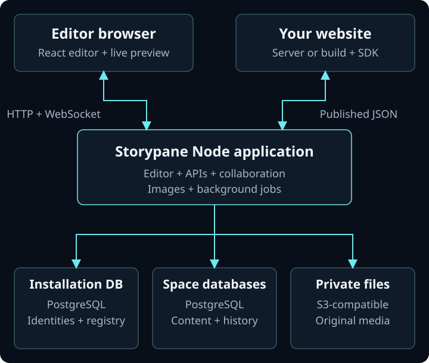
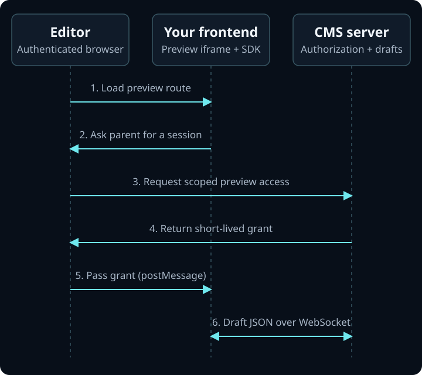

# Storypane architecture

Storypane has three main parts: a Node application, PostgreSQL databases, and
private S3-compatible file storage. Your public website is a separate application
that reads published content through the Storypane SDK or delivery API.

The Node application serves the React editor and runs the APIs, live collaboration,
and background jobs together. This describes the current Node/Docker release.



## What runs where

| Part                   | Responsibility                                                                                                                                     |
| ---------------------- | -------------------------------------------------------------------------------------------------------------------------------------------------- |
| Editor in the browser  | Shows stories, block fields, media, reviews, and your website's live preview. Sends edits to the CMS.                                              |
| Node application       | Serves the editor and HTTP APIs, checks access, manages collaboration sockets, processes images, and runs scheduled work.                          |
| Installation database  | Holds installation identities, local authentication records, administrator privileges, and the registry of space database connections.             |
| Space databases        | Each space stores its schemas, content, memberships, roles, history, publications, asset metadata, and queued work in its own PostgreSQL database. |
| Private object storage | Holds uploaded original files. The CMS controls access and produces resized or compressed images.                                                  |
| Your website           | Uses your components and routing to turn published content into pages, at build time or when a visitor requests them.                              |

The databases can share one PostgreSQL server. A database per space does not require
a separate server per space. Operators can also attach databases on other
PostgreSQL hosts. The bundled Docker setup runs the app, PostgreSQL, and MinIO;
the Railway template provisions the app, PostgreSQL, and a private bucket.

## A space is a data boundary

An installation is the CMS you deploy. A space is an independent content workspace
inside it, with its own database and dedicated database credentials.

After checking the user's session, the application resolves the requested space
through the installation registry and connects to that space's database. Connection
credentials are encrypted in the registry. Space membership, roles, and content
scopes determine what the user can read, edit, review, or publish.

Built-in Better Auth sign-in is the default. Optional Clerk or a custom server
authentication adapter establishes identity; Storypane still enforces installation
privileges and space permissions. See [authentication](authentication.md) and
[database isolation and hosting](self-hosting.md#existing-postgresql-and-object-storage).

## How content is stored

Within a space database, PostgreSQL stores the content's structure in relational
columns and its flexible field values in JSONB. A new content field is represented
in a versioned block schema and the block's JSONB values. CMS database migrations
manage the underlying SQL tables separately from these content-schema changes.

| Table                 | What it stores                                                                                                                                  |
| --------------------- | ----------------------------------------------------------------------------------------------------------------------------------------------- |
| `definitions`         | A block type's stable identity and name, such as `page` or `hero`.                                                                              |
| `definition_versions` | Versioned block schemas in the `schema` JSONB column: fields, types, defaults, and restrictions.                                                |
| `stories`             | Page identity and organization, including its name, space, and path.                                                                            |
| `story_locales`       | One locale of a story, its URL, root block, revision, and pointers to the current saved checkpoint and publication.                             |
| `block_drafts`        | One row per current draft block. Relational columns identify its locale, schema version, parent, field, order, and revision. `fields` is JSONB. |
| `checkpoints`         | Saved history: an editor `snapshot` and assembled page `content`, both JSONB, plus the actor, revision, and time.                               |
| `publications`        | Published versions, each tied to a checkpoint, with its own JSONB `snapshot` and assembled `content`.                                           |
| `assets`              | File metadata and object-storage keys. Original file bytes live in private object storage.                                                      |

### A page and its nested blocks

For a Home page with one Hero in its `body`, the draft rows look like this.
All rows belong to the same `locale_id`; the labels below stand in for UUIDs.

| `id`     | `schema_version_id` | `parent_id` | `parent_field` | `position` | `fields` (JSONB)    |
| -------- | ------------------- | ----------- | -------------- | ---------- | ------------------- |
| `page-1` | `page-schema-1`     | `NULL`      | `NULL`         | `0`        | `{"title":"Home"}`  |
| `hero-1` | `hero-schema-3`     | `page-1`    | `body`         | `0`        | `{"title":"Hello"}` |

The Hero's `parent_id` points to the Page block, `parent_field` puts it in `body`,
and `position` orders it among siblings. Deeper nesting uses the same structure.
Each block points to the exact `definition_versions` row used to interpret and
validate its fields. Reusable block definitions describe types; each block instance
has its own ID and values.

The application assembles these rows into the nested JSON your components expect:

```json
{
  "_uid": "page-1",
  "component": "page",
  "title": "Home",
  "body": [
    {
      "_uid": "hero-1",
      "component": "hero",
      "title": "Hello"
    }
  ]
}
```

`_uid` comes from the block ID; `component` comes from its definition name. The
`body` array is assembled from child rows. It is not the editing representation
stored in the parent block's `fields` column.

### Saved drafts and publications

A saved edit updates the draft rows, increments revisions, and writes a checkpoint
within a database transaction. `story_locales.checkpoint_id` identifies the current
saved state. Checkpoints currently retain full snapshots per autosave batch, so
history storage grows with page size and save frequency.

Normal draft preview reads that checkpoint's assembled `content`. Publishing
records the reviewed content in `publications` and advances
`story_locales.published_version_id`. Published delivery reads that publication's
`content`, while editors can continue changing draft rows and creating new
checkpoints. The two pointers let the latest saved draft and the live page differ.

## From editing to a published page

1. **Define the structure.** Developers create content types and reusable blocks.
   A page has a root block and nested blocks; fields describe text, media, links,
   and other content. Each locale has its own content and publication.
2. **Edit and save.** The editor sends changes to the CMS. The server checks
   permissions, validates fields and revisions, and commits changes to PostgreSQL.
   A block lease is a temporary editing lock that prevents conflicting edits to
   the same block while teammates work on other blocks.
3. **Share live updates.** WebSocket rooms distribute presence and saved changes
   to editors and authenticated previews. Responses are filtered for each
   recipient's permissions. PostgreSQL holds the durable state; the room's
   in-memory connections are recreated after a restart.
4. **Review and publish.** Publication selects a saved checkpoint, checks required
   approvals and linked content, and records the published version transactionally.
   Later draft edits remain separate. A content release can schedule approved
   page revisions to publish together.
5. **Render your website.** Your server or build uses a published-content token
   to fetch JSON through the SDK or delivery API. Your components render it.
   Static sites rebuild or revalidate when content changes; request-rendered
   sites fetch it as needed. Keep delivery and management credentials on the server.

Start with the [editor quickstart](editor-quickstart.md), then follow the
[SDK](../packages/sdk/README.md), [Astro](../apps/example-astro/README.md), or
[Next.js](../apps/example-next/README.md) integration guide.

## How live preview works

The preview is your actual frontend running inside an iframe in the editor. You
configure its URL in **Settings → API & preview**. Your preview route loads your
components and styles, and connects using `connectPreview` or the SDK's React hook.



1. **Load your frontend.** The editor opens the configured preview URL for the
   selected story and locale. A preview-mode signal activates the SDK integration.
2. **Request access through the editor.** The iframe SDK asks its parent for a
   session using `postMessage`. Both sides check the exact origin and source window.
   The editor requests a grant through its authenticated CMS session.
3. **Issue a scoped grant.** The CMS creates a five-minute, read-only preview
   session bound to the space, story, locale, and configured frontend origin. The
   editor passes the grant to the iframe, and the SDK renews it while authorized.
4. **Read saved drafts over WebSocket.** The iframe connects to the CMS at
   `/api/preview/live`. The server checks the grant and reads the latest saved
   checkpoint's assembled JSON. After edits are saved, the collaboration room
   sends updated authorized content to the preview.
5. **Render and select blocks.** Your frontend renders the received JSON with its
   own components. Elements marked with `data-storypane-id` can send block
   selections back to the editor. Selecting a block in the editor can highlight
   its matching element in the preview.

This path renders saved changes after autosave commits; input still waiting in an
editor buffer is outside the normal page-preview stream. Your preview route needs
client rendering or DOM updates to display incoming changes. Static server-rendered
HTML alone does not redraw when the SDK receives new JSON.

Preview grant hashes and scope are stored in the space database's
`preview_sessions` table. The installation database's `preview_routes` table maps
the token hash to the space so a connection reaches the right database. Preview
sockets accept sync and heartbeat requests, and do not acquire editing leases.
Session expiry, revoked access, and membership changes are rechecked during delivery.

Long-lived delivery, management, and server preview credentials stay on the server.
The iframe receives only its short-lived grant, without putting it in the preview
URL or relying on third-party CMS cookies. For a preview outside the CMS iframe,
your authenticated app server can supply a grant through `getSession`; see
[standalone preview and authorization](../packages/sdk/README.md#standalone-preview-and-authorization).

Block hover previews reuse this connection and your component renderer. Existing
blocks use saved content; the Add block picker can render schema defaults before
insertion. Release previews use the approved release snapshot, so later draft
changes stay outside that view. Ordinary published-content delivery continues
reading `publications`, independently of preview.

## Schemas and team environments

The recommended setup is one production space for editors and a linked development
space per developer. These are separate content databases within the same installation.

Developers change schemas in their dev spaces, review migrations, and promote
deployed changes to production. Schema promotion applies reviewed structural
changes to production content; it does not copy a developer's content or publish
drafts. Other developers explicitly sync from production before promoting their work.
See [production and development spaces](development-workflow.md).

## Media, automation, and scheduled work

Asset metadata lives in the space database; original bytes live in private object
storage under space-specific keys. The Node app handles uploads, access checks,
image resizing, and compression. Public delivery of published media is an explicit
option, and an edge image CDN can be configured separately. The bucket stays private.

Scripts and agents use the management API with scoped credentials. The SDK's
management client, CLI, and stdio MCP adapter call that API and follow the same
authorization and publishing rules. See [agents and automation](management-api.md).

Publication and webhook delivery have independent minute schedulers in the Node
process. Scheduled publications and webhook work are persisted in PostgreSQL;
webhooks use a transactional outbox and retry failed deliveries. A webhook can
trigger your site's rebuild or another integration. See [content releases](releases.md)
and [webhooks](webhooks.md).

## Deployment and scaling

Run **one application replica** in the current release. Collaboration rooms live
in that process, so adding app replicas requires a shared room transport first.
Keep the app running for live collaboration and scheduled work. Your public
website can use its own hosting and caching strategy independently.

Back up the installation database, every space database, original media,
configuration, and encryption keys together. A database-only backup cannot restore
the complete installation. Follow the [backup and upgrade guide](self-hosting.md#backups-upgrades-and-health).

`storypane.dev` is a separate static Astro marketing and documentation site, hosted
on Cloudflare Workers Static Assets. It is independent of a self-hosted CMS
installation. The CMS runs on Node/Docker; your own public website can use the
hosting and framework you choose.

## Where the code lives

These are code packages within the repository; the CMS deploys as one application.

| Directory                                 | Responsibility                                                                 |
| ----------------------------------------- | ------------------------------------------------------------------------------ |
| `apps/web`                                | React editor, authentication boundary, HTTP routes, and Node server.           |
| `apps/realtime`                           | Collaboration rooms, WebSocket messages, and recipient filtering.              |
| `packages/core`                           | Shared content contracts and validation.                                       |
| `packages/db`                             | Database transactions, permissions, migrations, history, and publishing.       |
| `packages/assets`                         | Uploads, asset access, and media delivery.                                     |
| `packages/runtime-node`                   | Node adapters for object storage, images, rooms, and scheduling.               |
| `packages/sdk`                            | Website delivery and preview clients, management client, CLI, and MCP adapter. |
| `packages/ui`                             | Shared editor controls.                                                        |
| `apps/example-astro`, `apps/example-next` | Separate example websites that integrate with the CMS.                         |

For installation instructions, continue with [local setup](getting-started.md),
[Railway](deploy-railway.md), or [self-hosting](self-hosting.md).
