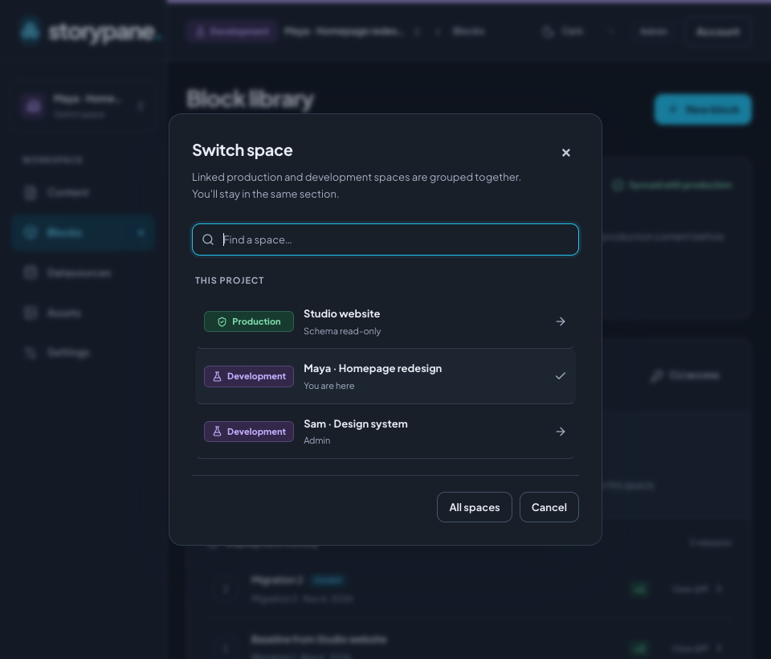
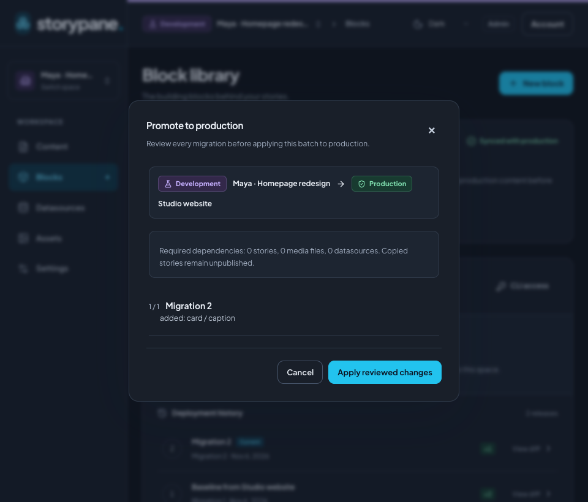

# Work with production and development spaces

For a new team, create one **Production** space for content editors and a linked
**Development** space for each developer. Keep production's schema read-only.
Developers change and test schemas in their own spaces, review the impact on
production content, then promote their deployed migrations.

All linked spaces belong to the same Storypane installation. Each has its own
database, content, media, members, and credentials.

| Space       | Who works here                     | What happens here                                                             |
| ----------- | ---------------------------------- | ----------------------------------------------------------------------------- |
| Production  | Content editors and release owners | Write, preview, and publish real content; receive reviewed schema promotions. |
| Development | One developer per space            | Iterate on blocks, deploy in this dev space, and test with sample content.    |

The everyday cycle is **sync → change → deploy in dev → test → promote**. After a
promotion, other developers sync before promoting their own work. Sync is explicit;
Storypane does not silently replace anyone's schema changes.

## Set up your team

Sign in to your [installed CMS](getting-started.md) as an installation administrator.
Only installation administrators create spaces and provision their databases.

1. From **Spaces**, choose **Create space**. Name it after the project, such as
   `Studio website`. Select **Production** and **Empty space** as its base, then
   choose **Create space**. Under **Database options**, the bundled installation
   uses **Create a database**; operators can instead attach a dedicated empty
   database as described in [self-hosting](self-hosting.md#existing-postgresql-and-object-storage).
2. Open production's **Settings → General**. Leave **Schema read-only** enabled.
   This protects block definitions, their library organization, and direct
   migration deployment. Content editing, preview, and publishing remain available.
3. Create another space named for a developer or task, such as
   `Maya · Homepage redesign`. Select **Development** and choose `Studio website`
   as the **Base space**. Check the displayed production link, choose **Review
   clone**, inspect the dependencies, then choose **Create space**.
4. Repeat for each developer, using production as the base. Invite content editors
   to production through **Settings → Members & roles**. Add each developer to
   their dev space; give release owners the access needed to deploy in dev and
   promote to production. Memberships and credentials are configured separately
   in every space.

For a new empty project, build the first schema in dev and promote it before
editors create production stories. The [editor quickstart](editor-quickstart.md)
walks through a Page and nested Hero model using this setup.

### What cloning copies

Cloning uses the base space's **deployed schema**. Deploy any active migration you
want included before cloning.

- Block definitions and stable field identities.
- The block library's **Parent block** hierarchy.
- **Blocks** field nesting rules, including allowed definitions and item limits.
- Configured locales and the datasource option lists required by the schema.

Content and media are not copied in bulk. The exception is dependencies required
by schema defaults: the clone review lists the stories and original media it must
copy, including transitive dependencies, up to 100 stories. Stories use published
content when available, otherwise drafts; all target copies start **unpublished**.
Create sample stories and upload test media in dev as needed.

Members, tokens, webhooks, integration credentials, and external option request
headers are not copied. Configure previews, credentials, and integrations for
each space. Creating another Production space from production creates an
independent project, not another destination for the original dev spaces.

## Know where you are and switch spaces

The header always names the current space and shows **Development** with a violet
flask or **Production** with a green shield. Check the text label before editing
content or reviewing a release; the environment is not indicated by color alone.

Choose the space name in the header, or **Switch space** in the sidebar. Under
**This project**, select the linked production or development space. The switcher
keeps your current section, such as Blocks or Content. An open story is not carried
across because each space has its own content. Resolve any unsaved-change prompt
before leaving.



## Change and test a schema in dev

1. Open your dev space's **Blocks** screen. If it shows **Behind production**, use
   **Sync from production** and review the incoming changes first.
2. Add or edit definitions, fields, allowed nested blocks, and library parents.
   Saving stages changes in this space's shared active migration.
3. In **Schema migrations**, choose **Review migration**. Inspect changes and
   affected content, resolve validation issues, then choose **Deploy migration**.
4. Create sample stories, try nested blocks, and test your frontend preview.
   Generate frontend types from the deployed dev schema for this testing.

**Deploy migration** affects the selected space. Deploying in dev does not change
production. Each dev space has its own active migration, so separate spaces keep
developers from sharing the same schema draft.

Both kinds of nesting travel with migrations: moving a definition under a
**Parent block** changes library organization, while editing a **Blocks** field
changes what editors may nest inside content. Review restrictive nesting changes
against production stories before applying them.

## Promote to production

You need deployment access in dev and production. Production's **Schema read-only**
setting can stay enabled: reviewed transfers are the supported way to update it.

1. In the dev space's **Blocks** screen, sync first if production has advanced.
2. Choose **Review promotion**. The **Promote to production** dialog names the
   source dev space and destination production space.
3. Review every migration, affected drafts and publications, and any required
   story, media, or datasource dependencies. This review uses actual production
   content, which can differ from your sample content.
4. Resolve blockers and read any data-loss confirmation. Choose **Apply reviewed
   changes** when the reviewed result is ready.
5. Switch to production, verify the blocks and content, then generate types from
   production's deployed schema and build or deploy the matching frontend.



Promotion applies the pending **deployed** dev migrations in order, in one
production transaction. An active schema draft is not included. If a step fails,
the batch is rolled back. Drafts and publications migrate separately, so schema
promotion never publishes unfinished content edits.

Required dependencies can be copied as unpublished drafts. Copying dependencies
preserves existing destination stories and media; schema migrations still
transform affected content. Differing required datasource values block a
transfer until you reconcile them. Removing fields or tightening nesting can
change existing content: review the impact rather than assuming a successful dev
deployment guarantees a successful production promotion.

## Plan content launches in production

Use [Content releases](releases.md) in production to group approved page revisions
under one publication time. Nested blocks are included in each approved page;
later draft edits stay unpublished. Editors can update the approved version,
move the page to another release, or publish it now and remove it from the group.
Schema protection can remain enabled. Releases stay in their own space and are
not part of schema promotion. A schema deployment holds affected releases so
editors can review their migrated content before resuming.

## Sync when another developer promotes

Other dev spaces show **Behind production** after a new production migration.
Open **Blocks → Sync from production** in each dev space, inspect the incoming
steps, resolve conflicts, and apply the reviewed changes before promoting again.

Sync reconciles changes by definition and field identity, including block parents.
It preserves immutable migration history and reconciles active schema work.
Conflicting changes require a dev or production choice. If combined parent moves,
deletions, or references would make an invalid schema, the review asks you to
choose the **complete dev or production schema for that step**. Recheck the entire
step before applying that choice.

Sync replays the incoming transformations; it does not simply replace the final
schema. Review data loss even if the final field types look familiar. Sync is not
an ongoing copy of production content into dev. Create representative sample
content for testing and rely on promotion review to inspect production impact.

## Use the CLI and your frontend

Install or link the [SDK CLI](../packages/sdk/README.md). Keep authoring credentials
pointed at dev and provide production credentials separately:

```sh
export STORYPANE_URL=https://cms.example.com
export STORYPANE_SPACE_ID=your-development-space-id
# Set STORYPANE_MANAGEMENT_TOKEN for dev in your secret store.
# Set STORYPANE_PRODUCTION_MANAGEMENT_TOKEN for the linked production space.

storypane migrations status
# Run only when status reports behind: true.
# storypane migrations sync
storypane migrations pull
storypane migrations create "Add hero caption"
# Edit storypane/migrations/active.json; preserve existing IDs.
storypane migrations push --deploy
# Test the deployed dev schema and frontend.
storypane migrations promote
storypane migrations pull
```

Uncomment and run `sync` when status reports incoming production changes. If `pull` finds an
active migration, edit it instead of creating another. Never reuse a production
token as the dev token. Sync requires deploy access in dev and read access in
production; promotion requires deploy access in both. See the
[CLI migration reference](../packages/sdk/README.md#linked-development-and-production-spaces)
for token scopes, conflict files, interrupted transfers, and CI confirmations.

Use production's space ID, delivery token, and deployed types in the live frontend.
Use dev's configuration and types in a local or test frontend. Migration version
numbers can differ between spaces, even when their schemas match. The
[production codegen example](../packages/sdk/README.md#linked-development-and-production-spaces)
keeps production snapshots separate from dev authoring files. Configure preview
URLs per space, and attach live-site [rebuild webhooks](webhooks.md) to production.

## Adopt the workflow for an existing project

An existing production space keeps its previous schema-editing behavior on upgrade.
An administrator can enable **Settings → General → Schema read-only**, then create
linked dev spaces from its deployed schema. Finish any active schema work you want
in the clone first. Existing production content stays in place.

If you started with an unlinked dev space, create a Production space using that dev
space as its base; Storypane links the original dev to the new production space.
Create or import real content into production separately. Cloning another dev
already linked to production makes a sibling dev linked to the same production;
use production as the base when you want a clean starting point.

| What you see                               | Next step                                                                                          |
| ------------------------------------------ | -------------------------------------------------------------------------------------------------- |
| Schema controls are read-only              | Switch to a linked dev space. Keep production protection enabled for routine releases.             |
| Review promotion is disabled               | Deploy your active dev migration, sync if behind, and check deployment permissions in both spaces. |
| A transfer reports a conflict              | Resolve the shown choices, review again, and apply the new review.                                 |
| Required datasource values differ          | Reconcile that datasource explicitly before reviewing again.                                       |
| CLI pull would overwrite local work        | Pull to a separate `--out` directory and reconcile; see the SDK reference.                         |
| The live site warns about a schema version | Generate types from production's deployed schema and rebuild the frontend.                         |

## Delete a space

Installation administrators can choose **Delete space** on the Spaces screen and
type its name to confirm. Delete linked development spaces before their production
space. Removing a space ends access through Storypane; its database is retained
by default for operator recovery. Choose **Also permanently delete the database**
to drop a database created by Storypane on the configured provisioning server.
This option is unavailable for attached databases or databases moved to another
server. Stored media and database roles are retained.
