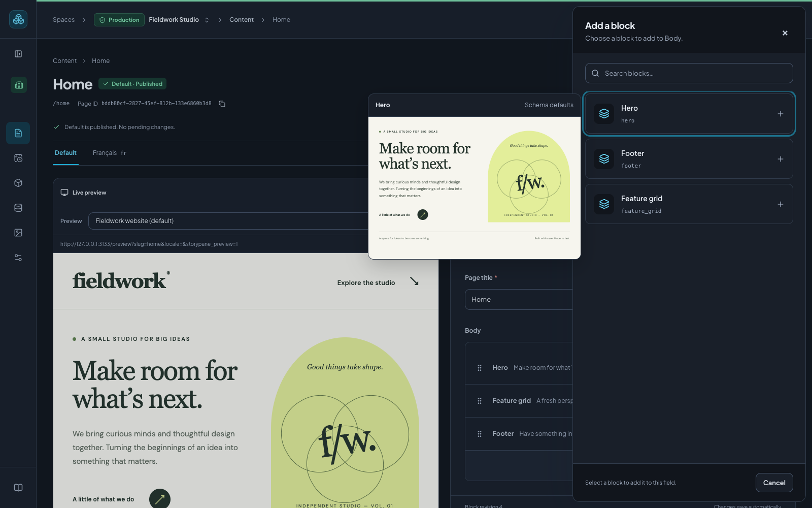

# Your first page in Storypane

Create linked production and development spaces, define reusable blocks in dev,
promote them, and publish a Home story in production using the editor.
You will finish with a saved page containing text and an image, plus a published
JSON snapshot you can inspect without connecting a website first.

## Before you start

Sign in to your running Storypane CMS. If you still need an installation, follow
[Install Storypane](getting-started.md). The public `storypane.dev` site is the
marketing website, so use your own CMS address for this walkthrough.

Use the installation administrator account to create the first space. You become
that space's administrator, which gives you the schema and publishing permissions
needed below. If you were invited into an existing production space with Page and
Hero already deployed, skip to [Create and fill the Home story](#6-create-and-fill-the-home-story).
Content editors do not need to create spaces or deploy schemas. Otherwise, ask
your installation administrator to prepare the linked spaces.

## 1. Create your first space

A space keeps a project's content, block library, assets, members, and settings
together. Each space uses its own database.

1. On the **Spaces** screen, choose **Create space**.
2. Set **Space name** to `Marketing website`. The description is optional.
3. Set **Environment** to **Production** and **Base space** to **Empty space**.
   New production spaces start with **Schema read-only** enabled; leave it enabled
   so schema changes arrive through reviewed promotion.
4. Expand **Database options** if needed. The bundled Docker setup uses **Create a
   database**. Operators can instead attach a dedicated empty database; see
   [database preparation](self-hosting.md#existing-postgresql-and-object-storage).
5. Choose **Create space**. Then choose **Create space** again and name the new
   space `Marketing website · Dev`. Select **Development** and choose
   `Marketing website` as the **Base space**.
6. Choose **Review clone**, inspect the review, then choose **Create space**. Open
   the new dev space. Check the **Development** label beside its name in the header.

The dev space starts with production's deployed schema. Clones exclude bulk content
and media; dependencies required by schema defaults are shown in the review and
copied stories stay unpublished. This empty project has none. For additional
teammates, create a dedicated dev space per developer as described in the
[team workflow](development-workflow.md).

The main navigation includes **Content**, **Releases**, **Blocks**, **Assets**, and **Settings**.
Use **Blocks** to define what editors can enter, then **Content** to create pages
from those definitions.

## 2. Plan the page structure

A **block definition** describes fields; a **block instance** holds the values for
one use of that definition. A **Content type** is a story's root definition. A
**Nestable** block is a reusable section inside another block's Blocks field.
**Universal** definitions can be used in either position.

Build this small model:

```text
Marketing website · Space
└── Home · Story using the Page content type
    ├── title: Home
    └── body · Blocks field
        └── Hero · Nestable block
            ├── title: Welcome to our website
            ├── description: A short introduction to our work.
            └── image: An asset from your library
```

Create **Hero** first so it is available when you configure the Page's allowed
blocks. Display names are labels for editors; technical names and field names
are used by your website code. Use the names below consistently.

## 3. Define the Hero block

1. Open **Blocks** and choose **New block**.
2. In **Config**, set **Display name** to `Hero` and check that **Technical name**
   is `hero`. Leave **Parent block** set to **No parent** for this walkthrough.
3. Under **Where can this block be used?**, select **Nestable**.
4. Open **Fields**. For each row below, enter the field name in **Name**, open the
   field-type picker, choose its type, then choose **Add**.
5. In each field's expanded settings, check its **Label** and set **Required to
   publish** as shown. Expand an existing field again if you need to edit it.

| Field name    | Field type | Label       | Required to publish |
| ------------- | ---------- | ----------- | ------------------- |
| `title`       | Text       | Title       | Yes                 |
| `description` | Textarea   | Description | No                  |
| `image`       | Asset      | Image       | No                  |

For Image, you can leave **Allowed file types** empty to accept supported assets.
Use an image file when filling this story later.

Choose **Create block**. The drawer stays open and reports **Saved to active
migration**. Close it using **Close dialog** before creating the next definition.

The **Parent block** setting organizes the block library. The **Blocks** field
created next controls how actual content is nested inside a page.

## 4. Define the Page content type

Choose **New block** again and configure:

- **Display name:** `Page`
- **Technical name:** `page`
- **Where can this block be used?:** **Content type**

In **Fields**, add:

| Field name | Field type | Label      | Required to publish |
| ---------- | ---------- | ---------- | ------------------- |
| `title`    | Text       | Page title | Yes                 |
| `body`     | Blocks     | Body       | Yes                 |

In Body's expanded settings:

1. Set **Minimum items** to `1`. Leave **Maximum items** empty so the page can
   contain more than one section.
2. Under **Allowed blocks**, use the **Blocks** tab, find **Hero**, and check it.
   This makes Hero available inside Body. Leaving all definitions unchecked would
   allow any Nestable or Universal block instead.
3. Choose **Create block**, then close the drawer.

## 5. Deploy the definitions

Saving a definition stages a schema change. Stories continue using the deployed
schema until an administrator deploys the migration.

1. In the **Schema migrations** panel in Blocks, find the **Active migration**.
2. Choose **Review migration** followed by its version number.
3. Review the Hero and Page additions and their fields. For a fresh, empty space,
   this change should add the two definitions without affecting existing stories.
4. Resolve any reported issues, then choose **Deploy migration**.
5. Check that **Current release** shows the deployed version and the workspace
   reports **All changes deployed**.

This deployment makes the schema available in dev. For this first migration you
should not need destructive deployment or data-loss confirmation.

Now promote the schema so content editors can use it in production:

1. In the dev space's environment panel, choose **Review promotion**.
2. Confirm that **Promote to production** names `Marketing website · Dev` as the
   source and `Marketing website` as the destination. Review Page, Hero, and Body's
   nesting rules, then choose **Apply reviewed changes**.
3. Choose the space name in the header. Under **This project**, select
   `Marketing website`. Confirm the header now says **Production**.

Continue below in production. Its schema remains read-only, but you can create,
edit, and publish stories. Schema deployment and story publication are separate
operations.

## 6. Create and fill the Home story

1. Confirm you are in **Production**, then open **Content** and choose **New story**.
2. Leave **Folder** as **Root**, set **Name** to `Home`, and set **URL slug** to
   `home`. Select **Page** under **Content type**.
3. Choose **Create story**. On a fresh space, edit the **Default** locale.
4. Select the Page root if it is not already selected. You can use **Outline**
   to find it. Set **Page title** to `Home`.
5. In **Body**, choose **Add block**, then choose **Hero** in the block picker.
6. Select that Hero row to edit its fields. Set **Title** to
   `Welcome to our website` and **Description** to
   `A short introduction to our work.`
7. Wait for **All changes saved**. Content autosaves as you edit; you do not need
   a separate Save button for a story.

The story's Name labels it in the content library. Page title and Hero Title are
content fields that your application can render.

If the preview pane says **Connect your app**, you can choose **Hide preview**
and continue editing. Connecting a website is optional for this walkthrough.

To insert between two blocks, hover over their divider or tab to its controls.
Choose the round **+** to open the block picker at that position. If you have a
compatible copied block, the round clipboard button pastes an independent copy
there. Touch screens keep these controls visible. Block limits and permissions
still apply. **Clear clipboard** in the editor header empties the clipboard and
removes the paste options; if the browser refuses clipboard access, the copy is
retained and an error is shown.

## 7. Add an image

1. In Hero's **Image** field, choose **Choose asset**.
2. In the asset picker, choose **Upload files** or drag a JPG or PNG into the
   library. Wait for the upload to finish, then select the image to attach it.
3. Fill **Alt text for this use** with a description appropriate to the page.
4. Wait for **All changes saved** again.

You can also upload and organize files from **Assets** in the main navigation.
Uploading a file adds it to the library; selecting it in an Asset field attaches
it to content. Image is optional in this model, so you can skip it and still
publish the page.

To add another section, select Page in the block breadcrumb or Outline, then
choose **Add block** in Body again. Each Hero instance has its own values. Drag
its handle to reorder sections.

## 8. Review and publish

1. Wait until all changes are saved, then choose **Review & publish**.
2. In **Review before publishing**, check the locale, URL, and changed components.
   Only components added, edited, moved or removed since the live version are
   listed. Expand a component to compare its changed fields. When there is no live
   version, a compact count offers an expandable list of all components; **View full
   saved content** is available for the complete JSON. Fix any validation issues,
   such as a missing Hero title or empty Body, before continuing.
   If you add story references later, review the linked-story
   publication choices here too.
3. Choose **Publish revision** followed by the reviewed revision number.
4. Check that the story is marked **Published**.
5. Choose **Published JSON** in the editor. Inspect the published Page content and
   its nested Hero, including the values you entered.

Try changing Hero's title and waiting for autosave. The status becomes
**Unpublished changes** while Published JSON keeps the previous publication.
Review and publish again when you want the new title to go live. Publishing uses
the fixed checkpoint you reviewed; later edits stay in the draft.

The slug `home` is the content path. Storypane does not create or deploy a website
at `/home` for you. Your application decides how published stories map to routes,
and static websites need a rebuild after publication.

To publish later, choose **Add to release** in the publishing review. Create a
named release or add this revision to an existing one. The **Releases** view lists
approved pages and flags newer drafts that are not included. Scheduled pages offer
**Update release** or **Publish now & remove from release** on their next review.
See [Content releases](releases.md) for planning, linked pages and conflict handling.

## 9. Connect a website and live preview

Your frontend must render `page` and `hero` definitions and use the Storypane SDK
for authenticated draft preview. The [Astro guide](../apps/example-astro/README.md),
[Next.js guide](../apps/example-next/README.md), and [SDK guide](../packages/sdk/README.md)
cover that integration. Their example setup creates its own Fieldwork space; it
does not automatically render the custom space you created above.

Once your application's preview route is ready:

1. Open **Settings → API & preview** and choose **Add preview URL**.
2. Set **Preview name** to a recognizable name such as `Local website`.
3. Set **Application preview URL** to your app's route, for example
   `https://your-site.example/preview?slug={slug}&locale={locale}`. Replace the
   example host with your running app's actual origin.
4. Mark it as the default preview and choose **Save preview settings**.
5. Return to Home and choose **Preview**. Edit Hero and wait for autosave to see
   the draft update in the connected application.

Use **Mobile**, **Tablet**, and **Desktop** in the live preview panel to check
responsive layouts. Mobile uses a 390px viewport; Desktop uses 1440px. Tablet is
the default and keeps the current panel width. Wider previews scale to fit the
panel. Switching sizes preserves the loaded page and live connection.

Keep an HTTPS CMS and its preview application on HTTPS. The integration guides
explain local development origins, iframe access, and draft media authentication.
Published content tokens belong on your application's server or build system;
never put them in browser code. See **Settings → API & preview → Access tokens**
when your integration needs a delivery token.

### Preview a component on its own

Once your frontend enables [component previews](../packages/sdk/README.md#block-hover-previews),
hover over a block row or focus it with the keyboard. After a brief delay, a
small iframe shows just that component using your website's renderer and styles.
This works in the block list, outline, breadcrumbs, and **Add a block** picker.



Existing blocks show saved content, including their nested blocks. Picker entries
show schema defaults with empty nested lists, so components without defaults may
look sparse. Hovering does not insert, save, publish, or take an editing lock.
Move away or press **Escape** to dismiss the preview; you can move the pointer
onto the preview to keep it open.

Previews use the selected preview URL and existing preview permissions. Only one
hover iframe is mounted at a time, and brief pointer passes do not start a preview
session. If you see **Enable component previews in your app’s Storypane SDK
integration**, update the app's SDK and connect its `onComponent` callback as
shown in the SDK guide. Both framework examples already include that integration.

## Explore page connections

Use the **View in map** icon beside a page in Content or the button at the top
right of an open page. Start with published content and two hops, then inspect
incoming and outgoing links. The map is read-only and respects content permissions. See the [page-map guide](page-map.md) for locale
fallback, saved drafts, optional content references, limits, and upgrade details.

## Continue with your team

- **Collaboration:** add a second Hero, then invite an Editor through
  **Settings → Members & roles**. Open Home in two signed-in browsers and select
  different Hero instances. Block locks protect the selected block while teammates
  work elsewhere on the page.
- **Locales:** configure them in **Settings → Locales**, then select a story's
  locale tab. Locale content is independent. Importing from the default locale is
  a one-time copy, not automatic translation; publish each locale separately.
- **Agent help:** use [For agents](https://storypane.dev/docs/agents/) for setup
  prompts, maintained skills, and scoped API/CLI/MCP access. An agent can help
  implement the frontend for this `page` / `hero` model; review its changes and
  keep your CMS credentials private.
- **Schema changes:** switch to your linked dev space, sync if production has
  advanced, then edit, deploy, test, and promote. Other developers sync after a
  promotion. Keep real content editing in production. The
  [team workflow](development-workflow.md) covers conflicts, CLI access, and
  generating the right frontend types.

## If something is missing

| What you see                                        | What to check                                                                                                                                          |
| --------------------------------------------------- | ------------------------------------------------------------------------------------------------------------------------------------------------------ |
| No Create space button                              | Sign in as an installation administrator, or ask one to create the space.                                                                              |
| No Page option when creating a story                | Confirm Page is a Content type and its migration has been promoted to production.                                                                      |
| No Hero in the Body picker                          | Confirm Hero is Nestable, promote its migration, and check Body's Allowed blocks selection.                                                            |
| Fields or deployment controls are unavailable       | Use a space administrator in a Development space. New Production spaces have their schema read-only; promote reviewed schema changes from Development. |
| Changes need attention or Offline · edits preserved | Resolve the shown error or restore the connection. Wait for All changes saved before reviewing a publication.                                          |
| Connect your app in preview                         | Configure an SDK-enabled frontend and its preview URL, or hide preview while editing content.                                                          |
| Published content does not change on the website    | Confirm the correct locale was published, then rebuild or revalidate your frontend.                                                                    |

## Add SEO & AI metadata

Use **Blocks → New block → Config → Use SEO & AI preset** for a reusable metadata
block. Add it to a dedicated `seo` field on your Page definition, with a maximum
of one block. The [SEO & AI guide](seo-ai.md) covers the fields, schema promotion,
frontend metadata, and optional published Markdown mirrors.
