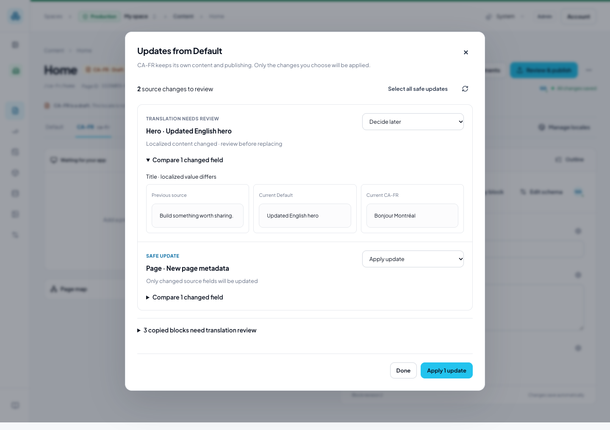
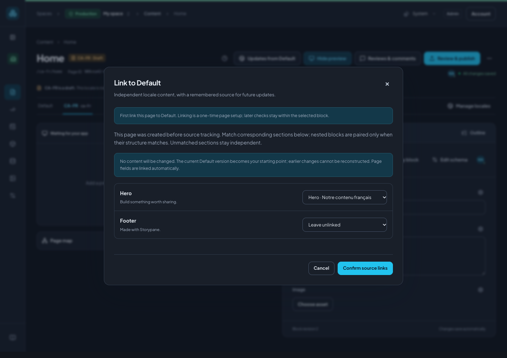

# Locales and updates from Default

Each locale is an independent page with its own fields, block structure, URL and
publication. Default can propose changes; it never silently overwrites a locale.
There are no runtime fallbacks, regional controllers or field override settings.

## Start a locale

Configure the locale in **Settings → Locales**, then open its tab in a story.
Choose **Updates from Default**. For an empty locale, the dialog offers **Create
from Default** with all top-level sections and page fields selected.

Deselect sections you do not need, or turn off **Page fields and metadata** to keep
those fields. Copying page fields explicitly replaces the current root fields;
the locale's URL, identity and publication state are preserved. Nested blocks
receive fresh IDs. Copied blocks are marked as needing translation review.

The source is the saved Default draft. Source edits made after the copy do not
change the localized page until an editor accepts an update.

## Review source changes

Choose **Updates from Default** in the story toolbar. Only changes since the last
copy or source review are shown. An intentional translation alone is not a source
change. If nothing changed, the dialog says the locale is up to date and preserves
its local edits.

- **Safe update:** the changed source fields have not been changed locally, or
  already match the new source. These updates are selected by default.
- **Translation needs review:** at least one changed source field was edited
  locally. Expand **Compare changed fields** to see the previous source, current
  source and current locale. **Replace changed fields** is an explicit choice;
  unchanged fields and unrelated translations are preserved.
- **New section:** add an independent copy, marked for translation review.
- **Removed in source:** explicitly remove the localized section and its nested
  content, or keep it. Removal is never preselected.
- **Section moved / Layout change:** review the proposed structure explicitly.
  Reordering linked blocks keeps local-only blocks in their existing slots.

Choose **Keep [locale] version** to acknowledge that source change without applying
it. A later source edit can still appear. **Decide later** leaves it pending.
**Select all safe updates** selects safe changes only. Nothing is applied until
you use the final action button, and all applied content stays in the draft.

A source or target edit while the dialog is open makes its review stale. Refresh
and review the updated choices. Another editor's block locks also prevent the
operation. Existing required content reviews continue to govern publishing;
applying changed content invalidates approvals using the normal review rules.

## Check just one block

The globe action beside a block's heading opens **Updates to [block]**, limited
to that block and its descendants. A local-only block explains that it has no
source counterpart. Use the story toolbar for the whole page.

## Link an existing locale

Older imports did not remember which source blocks they copied. The first review
therefore offers **Link to Default**, without guessing historical correspondence.

Match each source section to its existing localized section. Its descendants can
be linked together only when the nested block types and fields have the same
structure. Leave adapted or unmatched sections unlinked. Page fields are linked
automatically. Confirming links changes no content: the current source becomes
the baseline, and earlier source changes cannot be reconstructed.

Future changes to an omitted source section can be offered as an optional copy;
it will not overwrite an unrelated local section. A deliberate copy through
**Copy blocks from Default…** remains a separate operation that adds independent
blocks, starts unselected, and does not update existing blocks.

## Translation review and boundaries

Expand **Copied blocks need translation review** to track copied content. Choose
**Mark reviewed** after translating or checking a block. These markers are
advisory and do not grant approval or publish anything.

- Reviewing updates currently requires read access to all fields and references
  in both locales and the remembered source baseline. Applying choices also
  requires edit access to the whole destination locale and its root edit lock.
  Restricted source values are never returned in comparisons.
- Changed block schemas must align before their field updates can be applied.
- Source links are private editing metadata. Delivery and SDK integrations still
  read the independently published locale; no website changes are required.
- Restoring a content checkpoint does not rewind source-review acknowledgements.
  Duplicated stories and independent block copies need their own explicit links.
- Changing which locale is Default does not silently reassign an existing source
  relationship. Restore the original Default before reviewing that relationship.

Upgrades add space migration **033_locale_sources** through the transactional
migration runner. Existing locales are not linked or rewritten by the migration.
Source links and baselines are retained when splitting a legacy multi-space database.
