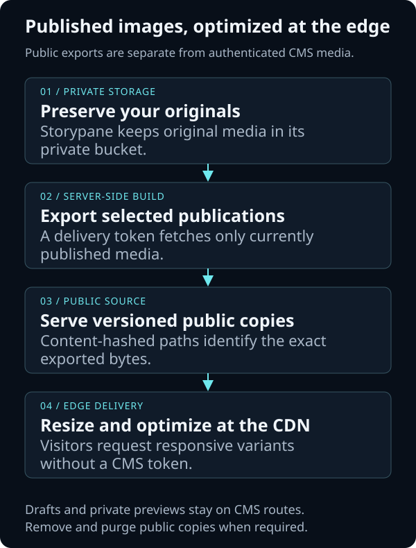

# Media CDN and edge-optimized images

Deliver responsive images from a CDN while keeping Storypane's original media
private. This guide uses **Cloudflare Image Transformations** with a public copy
of selected published images. The same export boundary works with another image
CDN; its URL format, configuration, and purge behavior will differ.

This is a frontend/build integration. Installing Storypane or deploying its
Railway template does not configure a CDN. Your team chooses which published
images may be copied publicly and operates their removal policy.



## 1. Choose the right delivery boundary

| Delivery path                | Use it for                                  | Caching and access                                                                                       |
| ---------------------------- | ------------------------------------------- | -------------------------------------------------------------------------------------------------------- |
| Storypane `publicAssetUrl`   | Responsive images without another service   | Opt-in public media; live eligibility checks and `no-store`. Variants run on the Node server.            |
| Published-image export + CDN | Public websites that need edge optimization | Only selected public copies enter the CDN. Your build and purge workflow controls their lifecycle.       |
| Authenticated editor preview | Drafts and private media                    | Keep the existing SDK preview integration and CMS authorization. Do not send these URLs to a public CDN. |

Storypane's public-media setting is **not required** for server-side export.
`client.getAsset(assetId)` uses a delivery token and only returns assets referenced
by a current publication in that space. Draft-only and historical references do
not qualify. See the [SDK media contract](../packages/sdk/README.md#media).

Do not put a cache-everything rule in front of the CMS, override its `no-store`
headers, expose bucket credentials, or give the CDN an editor session or token.
Choose direct Storypane delivery when an immediate eligibility check is required
on every request. Exported copies cannot provide that guarantee.

## 2. Export selected published images during your build

The [Astro](../apps/example-astro/README.md) and
[Next.js](../apps/example-next/README.md) examples already export publication assets
through `getAsset`. Their existing `/media/{assetId}` paths are not content hashes;
adapt that export step when using long-lived caches.

Use your production delivery client on the server or build runner. Enumerate the
image fields you intend to publish from current delivery stories, including their
published references. Do not enumerate the private bucket or export every upload.

For a versioned public copy, adapt this Node helper in your frontend's build code:

```js
import { createHash } from 'node:crypto';
import { mkdir, writeFile } from 'node:fs/promises';
import { join } from 'node:path';

export async function exportPublishedImage(client, assetId, outputDirectory) {
  const response = await client.getAsset(assetId);
  if (!response.ok) throw new Error(`Image export failed (${response.status})`);
  const mime = response.headers.get('content-type')?.split(';')[0].trim();
  const extension = new Map([
    ['image/jpeg', 'jpg'],
    ['image/png', 'png'],
    ['image/webp', 'webp'],
    ['image/avif', 'avif'],
  ]).get(mime);
  if (!extension) throw new Error('Export a supported raster image');

  const bytes = Buffer.from(await response.arrayBuffer());
  const hash = createHash('sha256').update(bytes).digest('hex');
  const filename = `${hash}.${extension}`;
  await mkdir(outputDirectory, { recursive: true });
  await writeFile(join(outputDirectory, filename), bytes);
  return `/storypane-media/${filename}`;
}
```

Pass an output directory **inside a fresh build staging area**, mapped to the
public `/storypane-media/` path by your frontend. For example, a build script can
stage these files under its generated public-assets directory. Keep an
`assetId → returned path` manifest for your renderers. Process images sequentially
or with bounded concurrency: this helper buffers one original per call.

Use the provider's [supported formats and limits](https://developers.cloudflare.com/images/get-started/limits/).
Start with JPEG or PNG originals; check plan support before exporting AVIF inputs.
The helper rejects SVG, video, and arbitrary downloads, but does not inspect files
for animation. This recipe targets still images; handle animated PNG/WebP inputs
explicitly before including them. Original bytes are preserved; transformations
happen at the CDN.
Fail the build on an export error, and deploy only a complete successful build.
Keep the previous deployment available if a build fails.

## 3. Connect a public image source to Cloudflare

1. Serve the generated directory over HTTPS on a hostname you control, such as
   `images.example.com`. This hostname serves **only the exported public copies**;
   it does not expose your private Storypane bucket.
2. Put that hostname behind Cloudflare's proxy. In **Images → Transformations**,
   select its zone and enable transformations. Review the current
   [setup requirements](https://developers.cloudflare.com/images/optimization/transformations/overview/)
   and [pricing](https://developers.cloudflare.com/images/pricing/).
3. Under **Sources**, restrict additional source origins to hosts you own. Do not
   enable arbitrary remote sources. Same-zone sources are allowed by default;
   additional subdomains must be configured explicitly where required. Follow
   [Cloudflare's source-origin instructions](https://developers.cloudflare.com/images/optimization/transformations/sources/).
4. Configure cache headers on the **exported image directory**, not CMS routes.
   Start with a short policy such as `Cache-Control: public, max-age=300` and an
   ETag. Choose a longer browser TTL only after accepting its removal delay.
   Content-hashed names prevent changed bytes from reusing an old URL, but do not
   revoke old URLs by themselves.
5. Verify the source image loads anonymously at its generated path before
   requesting a transformation.

For example, if the exported original is at
`https://images.example.com/storypane-media/<content-hash>.jpg`, request:

```text
https://images.example.com/cdn-cgi/image/width=640,quality=80,format=auto,fit=scale-down/storypane-media/<content-hash>.jpg
```

Replace the hostname and hash with your actual values. URL transformations run
through Cloudflare, with cache hits served at the edge. `format=auto` negotiates
an output format; `fit=scale-down` avoids enlargement. See the
[transformation options](https://developers.cloudflare.com/images/optimization/features/).

## 4. Add responsive images to your renderer

Use the exported path from your build manifest. These URLs contain no CMS token.
This example assumes a 1600 × 900 source image; use your image's real dimensions
and alt text. Adjust `sizes` to match the rendered layout.

```html

```

Keep a small set of widths to limit variant churn. For a page's main hero image,
omit lazy loading when it would delay the largest visible image. Start without
cropping. Storypane's focal-point metadata is not embedded in the exported bytes;
using CDN cover crops requires explicitly mapping that metadata to the provider's
crop options and rebuilding when it changes.

Preview rendering must continue using the authenticated SDK preview asset path.
A draft-only image should work in the editor without being exported publicly.

## 5. Rebuild, remove, and purge

Connect [production webhooks](webhooks.md) to your existing build queue. Re-read
current publications after publication, unpublication, deletion, asset updates,
and relevant schema deployment. Verify webhook signatures and the expected space;
coalesce repeated builds rather than trusting an event as a content snapshot.

For each successful build:

1. Recompute the current selected public-image manifest from published content.
2. Export into a fresh staging directory and update image paths in rendered pages.
3. Deploy the complete result. Removing an image from one page must not remove a
   shared copy still used by another publication.
4. Remove no-longer-approved copies from **every serving origin**, then purge their
   original source URLs from the CDN. Track the prior manifest to identify them.
5. Test the old original URL and every previously served variant anonymously.

Cloudflare documents a minimum transformation cache time of one hour and purging
by the **original source URL**, which also purges its variants; transformed
`/cdn-cgi/` URLs cannot be purged individually. Review its
[caching and purge behavior](https://developers.cloudflare.com/images/optimization/features/#caching)
before promising removal times. Browser caches and downloaded files cannot be
recalled by a CDN purge.

If your host retains old deployments or preview URLs, deleting the file from the
new build alone is insufficient. Restrict or retire those old serving origins too.
Disabling **Public media delivery** in Storypane does not delete exported copies.

## 6. Verify before launch

- Request two image widths from a clean browser. Check actual dimensions, MIME
  type, visual quality, and transferred bytes in the Network panel.
- Repeat with the same parameters. Confirm edge cache behavior in Cloudflare's
  diagnostics and reduced origin requests; latency alone does not prove a hit.
- Test a publication with a referenced image and a separate draft-only upload.
  Only the selected published image may appear in the export manifest or CDN.
- Change an image, rebuild, and confirm its URL changes. Exercise unpublication,
  removal of the last reference, deletion, and a shared-image reference.
- Purge an old source and check its original and variant URLs, including alternate
  hosts. Record your measured removal window and browser-cache limitations.
- Verify private editor media and preview responses retain authorization and
  `no-store`. Inspect generated HTML and JavaScript for credential exposure.

This guide's exporter and URL examples have local automated checks. A real CDN
zone, billing configuration, transformation result, and purge/removal behavior
must be verified by the implementer before launch.
