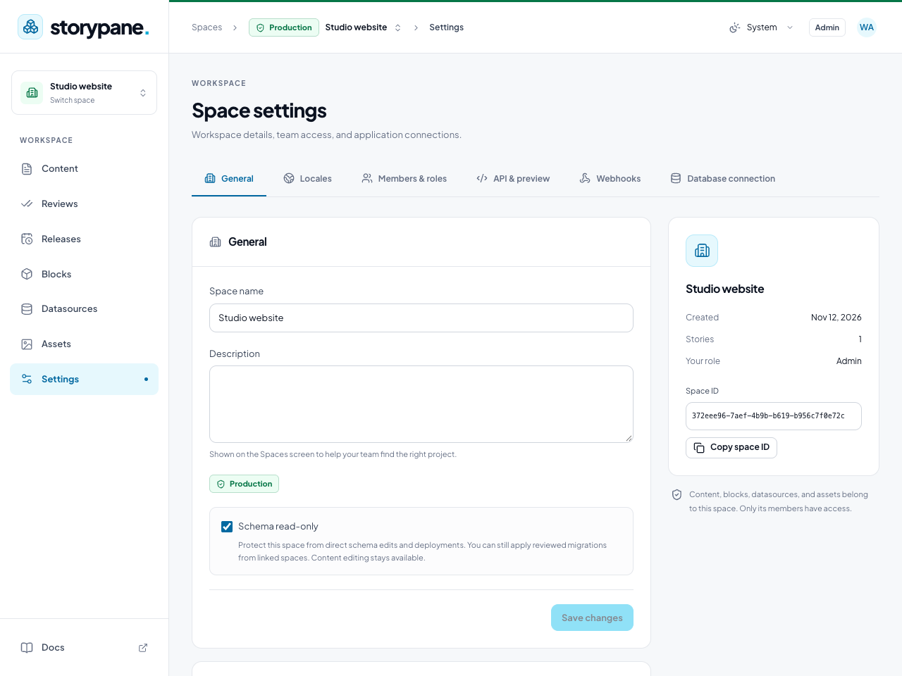
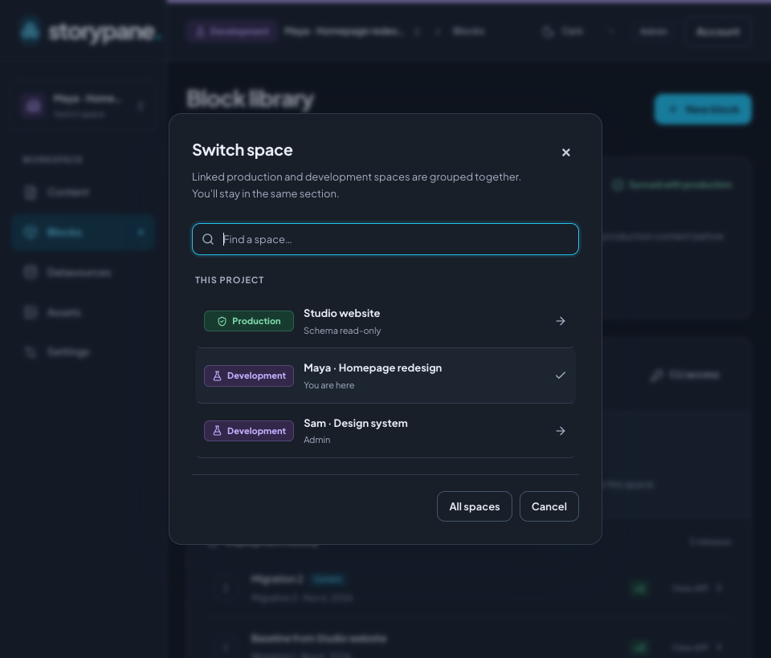
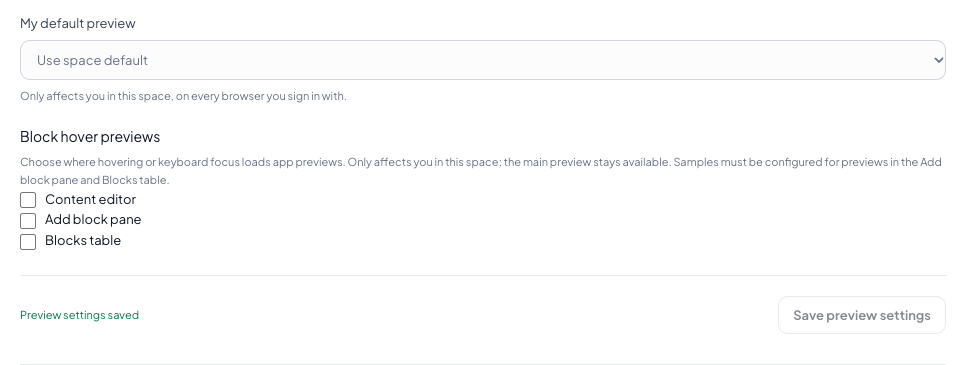

# Recommended setup

Use this checklist when you first sign in to Storypane. Start with a protected
production space for real content, a linked development space for schema work,
and a frontend configured for each environment.

If you joined an existing team, ask which space to use before creating anything.
Content editors can start in the team's production space and skip the developer
steps. Only installation administrators can create spaces; a space administrator
controls its schema protection. Every member can adjust their own preview preferences.

## 1. Get your CMS running

Already signed in to your team's CMS? Continue to the next step. Otherwise, follow
[Local setup](getting-started.md) or [Deploy on Railway](deploy-railway.md), then
sign in with the administrator created during installation.

A **Development space** is a separate CMS workspace for testing your content model.
Your **local development environment** is the website running on your computer.
You can connect a local website to a dev space on a hosted CMS; you do not need
to run another CMS locally. To change Storypane itself, use the separate
[source-development instructions](getting-started.md#develop-from-source).

## 2. Protect your production space

1. On **Spaces**, choose **Create space**. Give it a project name such as
   `Studio website`, select **Production**, and use **Empty space** as the base.
   Choose **Create space**. If your team already has production, open that space.
2. Open **Settings → General** as a space administrator.
3. Keep **Schema read-only** checked and choose **Save changes** if you changed it.
   New production spaces already have this enabled. Existing spaces may need it
   enabled after an upgrade.

This is the setting to use when you want to “turn migrations off in production”:
it prevents direct schema edits and direct migration deployments. Reviewed
promotions from linked dev spaces still work, so leave the protection enabled
for normal schema releases. Editors can continue writing, previewing, and
publishing content.

Schema protection does not disable the operator's database upgrade migrations.
Operators must still run the supported migration runner when upgrading Storypane;
never use the local fixture command `db:setup` on production.

## 3. Create a linked dev space

1. Return to **Spaces** and choose **Create space**.
2. Name it for the developer or task, such as `Studio website · Maya`.
3. Select **Development** and choose your production space as the **Base space**.
4. Choose **Review clone**, check the dependencies and production link, then
   choose **Create space**.
5. Open it and confirm the **Development** label in the header. Keep schema
   editing available in this space. Repeat for each developer.

Cloning starts from the deployed schema. It does not copy bulk content or media;
any dependencies required by schema defaults appear in the review, and copied
stories start unpublished. Add representative sample content in dev. Memberships,
tokens, preview URLs, and integrations must be configured separately in each space.

Work in this order: **sync → change schemas → deploy in dev → test → review promotion →
apply to production**. Deploying in dev does not update production. Promote only
after testing, and have other developers sync afterward. Follow
[Production and development spaces](development-workflow.md) for the complete
review and conflict workflow, or the [Editor quickstart](editor-quickstart.md)
to build your first blocks and publish a page.

## 4. Connect your local website to dev

1. Choose the [Astro](../apps/example-astro/README.md) or
   [Next.js](../apps/example-next/README.md) integration guide and follow its
   installation and environment-file instructions.
2. Use your **dev space ID** and a delivery token from that space for the local
   website. Generate types from that same space's **deployed** schema.
3. Start the website using the framework guide. Implement its authenticated
   Storypane preview integration before adding a preview URL in the CMS.
4. In the dev space, open **Settings → API & preview → Add preview URL**. Name it
   `Local website`, enter your app's actual preview route using `{slug}` and
   `{locale}` where appropriate, and choose **Save preview settings**.
5. Select it as **My default preview** and save. This personal choice follows you
   across browsers in this space. **Space default** is shared with the team, so
   reserve it for a preview host they can all reach.
6. Open a sample story and choose **Preview**. Edit a field, wait for
   **All changes saved**, and confirm that the preview updates.

`localhost` in a preview URL means the computer of the person using the editor.
Use it for your own local app, and a reachable shared host for team previews.
An HTTPS CMS needs an HTTPS preview app; use the framework guide's origin and
iframe configuration when the two run on different hosts.

Keep tokens in ignored local environment files or your host's secret settings.
Delivery and management tokens belong on the server or build system, never in
browser bundles or preview URLs. Use separately scoped management tokens only
if you need CLI or agent access.

For the live website, use **production's** space ID, delivery credentials, and
generated types. Rebuild or revalidate after publication, using
[production webhooks](webhooks.md) when your frontend needs them. Test publication
and the live site before inviting the rest of your team.

## 5. Adjust previews if the editor feels slow

Application previews run your website inside the editor. Component hover previews
can also load your website's renderer. If typing or moving between blocks feels
slow, try editing with those previews closed:

1. In an open story, choose **Hide preview** to close the main application preview.
   Open **Preview** again whenever you need a visual check.
2. Open **Settings → API & preview → Block hover previews**.
3. Uncheck **Content editor**, **Add block pane**, and **Blocks table** to stop
   loading hover previews in those areas, or leave only the ones you use enabled.
4. Choose **Save preview settings**, return to the story, and try the same edits.

Hover preferences affect only you in the selected space and follow your account
across browsers. They do not disable the main application preview; close it
separately with **Hide preview**. Neither action stops content saving,
collaboration, or publishing. You can re-enable previews at any time.

Keep **Page map** collapsed when you do not need it; it loads only when expanded.
If performance is still poor with previews closed, check whether your standalone
website is also slow and share the affected story size, browser, and steps to
reproduce with your installation administrator. For **Offline · edits preserved**
or save errors, restore the connection and resolve the error before publishing;
disabling previews does not fix a failed save.

## 6. Bring in your team

- Invite people through **Settings → Members & roles** in the space they need.
  Keep content editors in production and schema developers in their linked dev spaces.
  Give each person only the permissions and content access they need.
- Configure [locales](locales.md) before creating translated pages. Set up
  [reviews](reviews.md) if someone must approve content before publication.
- Ask your operator to configure recovery and backups for the installation database,
  every space database, original media, configuration, and encryption keys. Follow
  the [deployment acceptance checklist](deployment-verification.md) before treating
  a fresh installation as ready for production.

You are ready for everyday work when production is protected, developers can test
and promote from dev, the frontend uses the correct space, and editors can save,
preview, and publish a test page successfully.
