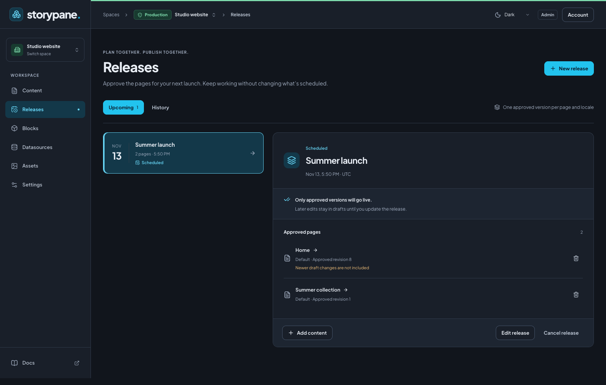

# Content releases

Requested [reviews](reviews.md) must satisfy their approval requirements before
scheduling or publishing the selected content. The server checks again when a
release runs; a blocked member prevents partial publication of the release.

Group approved pages into a named release and publish them together at a scheduled
time. Keep writing your next draft without changing what is going live.

<aside class="agent-instructions" aria-labelledby="set-up-with-an-agent">

<div class="agent-instructions-top"><span class="eyebrow">For coding agents</span></div>

## Set up with an agent

Copy these instructions into your coding agent. Use your **production** space for
real content; development spaces remain the place to iterate on schemas.

```text
Help me prepare a Storypane content release. Read docs/releases.md and AGENTS.md.
Confirm the production space, pages and locales, release name, timezone and time.
Use the existing publishing review to inspect each saved version, its nested
blocks and linked-page choices. Show me the approved revisions and any existing
release memberships before scheduling or moving pages. Keep later drafts out.
Use scoped management credentials only if automation is needed; keep tokens secret.
Retain request IDs on retries, refresh stale reviews, and report any release on
hold. Do not publish immediately or include additional pages without my instruction.
```

</aside>



## How releases work

- A page locale can belong to **one upcoming release**. Different locales can
  have different releases. A space can have several releases.
- Each member pins an approved saved revision, including the complete nested
  block tree. Autosaving later edits does not change that approval.
- All members share the release's date, time and timezone. A release can contain
  up to 100 page locales.
- At publication time, Storypane checks permissions, schema compatibility and
  content validity again. It publishes every member in one database transaction.
  If one fails, none of that attempt goes live.

Releases belong to a single space. They are separate from schema migrations and
are not cloned, synced or promoted between development and production spaces.
Keep production's **Schema read-only** protection enabled: content releases do
not need schema editing access.

## Schedule a page

1. Open the page and locale in **Content**. Wait for **All changes saved**.
2. Choose **Review & publish**. Check the URL and components changed since the live
   version. Expand a component to compare its changed fields, and review validation
   results and linked-page choices. This comparison uses live content, even when
   updating an upcoming release; it is not a comparison with that release's approval.
3. Choose **Add to release**.
4. Select **Create a new release**, enter a clear name such as `Summer launch`,
   then choose the **Release date and time** and **Timezone**. Use an IANA zone
   such as `America/Vancouver` or `UTC`.
5. Choose **Create release & schedule**. The editor shows the release name,
   scheduled time and approved revision, with a **View release** link.

Alternatively, select an existing release and choose **Add to release**. Its time
applies to this page too. When a clock change repeats a local time, choose the
intended UTC offset; skipped times cannot be scheduled.

## View the approved version

When a page locale belongs to an upcoming release, check **View release version
(read-only)** in its story editor. Storypane saves pending edits before switching.
The fields, nested blocks and application preview show the approved release
version. Editing and publishing controls are disabled while it is checked.
Uncheck it to return to your current draft.

The preview uses approved linked pages from the same release and live content for
other published references. Omitted references stay omitted; newer drafts are not
included. It uses your existing preview URLs and SDK integration. Changing,
canceling or publishing the approval invalidates its preview session.

Reviews remain tied to their content versions. Editing or reviewing the next draft
does not discard approval of the version already scheduled. Reviewer permissions
are checked again when the release runs.

## Plan a release first

Open **Releases** in the left menu and choose **New release**. Name it and set its
time. Choose **Add content**, open a page, and follow the publishing review above.
The selected release is offered in the page's release picker.

The **Upcoming** view shows scheduled releases and those needing attention.
Select a release to see its approved pages, locales and revisions. **Newer draft
changes are not included** means the current saved draft differs from the approved
version. An empty release does not publish anything.

## Edit a page that is already scheduled

Autosave continues normally. When you review the next saved version, choose:

| Action                                | Result                                                                                                                          |
| ------------------------------------- | ------------------------------------------------------------------------------------------------------------------------------- |
| **Update release**                    | Replace the approved version with the revision you just reviewed; retain the release time.                                      |
| **Publish now & remove from release** | Publish the reviewed version immediately and remove this page locale from its upcoming release. Other members remain scheduled. |
| Close the review                      | Keep the new draft; the previously approved version remains scheduled.                                                          |

To move a page, choose **Update release**, select a different release or create a
new one, and confirm **Move to release**. The form names the source release.
Moving a page does not move other members automatically. Bulk publishing directs
you to the editor for scheduled pages so you can make this choice explicitly.

If someone changes a release or the page's scheduled version while your review is
open, refresh and review again. Storypane rejects stale approvals instead of
silently replacing someone else's changes.

## Nested blocks and linked pages

Nested blocks are part of the page's approved snapshot, including their field
values, order and structure. Later edits to a nested block stay in the draft.

Linked pages are separate content. The publishing review lets you approve selected
linked pages for publication alongside the main page; those approved pages become
members of the same release. References you choose to omit are omitted from the
approved publication, without deleting them from the draft. Already published
references can continue using their live content.

A linked page already scheduled in another release must be moved explicitly
before including it. Publishing a page immediately cannot silently publish a
linked page that belongs to a release. If a required linked approval is removed,
changed, or independently published with a different revision, the release needs
another review before it can go live.

## Reschedule, remove or cancel

- **Edit release** changes its name or shared publication time. It keeps the
  approved revisions; it does not pull in newer drafts.
- Use a page row's **Remove from release** action to remove only that member.
  Review any other members that depended on publishing it.
- **Cancel release** cancels the whole group after confirmation. Current live
  content and drafts remain unchanged.
- **History** contains published and cancelled releases.

Reading a release requires access to all its page locales. Managing the whole
release requires publishing access to every member. A page can still be managed
through its own authorized publishing controls.

## When a release needs attention

A permission change, schema migration, invalid content or changed linked approval
can put the release on hold. The release keeps its page memberships and explains
why it stopped. No pages from the failed attempt are published.

1. Open the release and read the error.
2. Resolve the problem. After a schema change, review and **Update release** for
   each affected page. If an approver lost access, an authorized publisher must
   approve their pages again.
3. Choose **Review & resume**, select a future time and save. Updating approvals
   alone does not resume a held release.

Temporary infrastructure failures retry the entire release after 1, 5, 15 and
60 minutes, then hold it after five failed attempts. The application checks due
releases at startup and every minute, so publication is not exact to the second.
The CMS must be running; an overdue release is checked when it comes back online.

Legacy schedules created before approved snapshots were stored require **Update
release** before the read-only preview is available.

Legacy schedules are retained as individual releases during upgrade. Old failed
schedules appear under **Needs attention**; resume them only after review. A newer
active schedule for the same page takes precedence until you explicitly resolve
its membership.

## Websites and automation

The delivery SDK continues to return published content. No frontend contract
changes are needed: `client.listAllStories()` still reads the default locale when
options are omitted. Static websites must rebuild, and cached websites may need
revalidation after publication.

A successful release creates the existing `story.published` webhook events for
its pages in the same transaction. These arrive as separate deliveries; coalesce
build requests when several pages go live together. There is no release-level
webhook event. See [webhooks](webhooks.md).

Use the [management API](management-api.md#content-releases) for release creation,
rescheduling and cancellation, and the existing scheduling endpoint to approve
members. Always carry the reviewed revisions and reuse a request ID only for an
identical retry. The [SDK management client](../packages/sdk/README.md#management-api)
can call these endpoints through `request()`.
