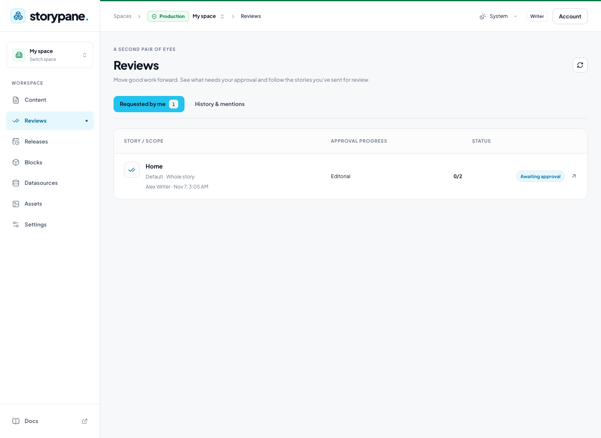

# Reviews and comments

Ask for another pair of eyes on a whole story or one block before publishing.
Comments start a conversation; a review request adds an approval requirement.
Both use the same composer and preserve the story’s locale and access rules.

## Set up reviewers and Teams

An administrator manages **Teams** under **Settings → Members & roles**. Choose
**Create team**, give it a name, select its members, and set **Minimum approvals**.
For example, a team of three with a minimum of two passes when two eligible
members approve. You do not need every member’s approval.

Grant reviewers **Review content** in their role. Review permission is separate
from **Publish content**: approving a request does not grant publishing access.
Reviewers also need read access to the requested content. Team membership and
@mentions never grant access to otherwise restricted stories, blocks or fields.

Every individually assigned reviewer must approve, and every assigned team must
reach its own threshold. The requester cannot approve their own request. Teams
without enough eligible reviewers cannot be selected. A request records the
team membership and threshold at creation; later team edits apply to new requests.

## Start a comment or request a review

1. Open the story and choose **Reviews & comments**, or use the comment icon in a
   block’s heading or block-list row to target that block.
2. Write your comment. Type `@` to search accessible members by name or email;
   use the mouse or arrow keys and Enter/Tab to select one. Escape closes the
   suggestions without closing the dialog.
3. To require approval, turn on **Request review**. The reviewer fields appear
   below the message. Choose people, Teams, or both.
4. Choose **Post comment** or **Request review**. Pending changes are saved before
   the request is created. The composer retains your text and mentions when you
   switch between comment and review modes.

Editors without Publish permission see **Request review** in the story toolbar.
It opens this same composer with the review switch already on. Its message is
optional; ordinary comments need text. Existing discussions remain below the
composer and can be opened to read the conversation.

A mention brings a discussion into the recipient’s **History & mentions** view.
It does not assign that person as a required reviewer. Mention suggestions remove
a recipient from the message payload if you delete or edit the selected mention.
Storypane does not send review email notifications in this version.

## Use the Reviews inbox

Open **Reviews** in the sidebar:

- **Available to review** lists requests that need your decision, including team
  requests you can act on. The sidebar badge counts available reviews.
- **Requested by me** tracks your pending requests.
- **History & mentions** includes past activity and discussions mentioning you.

Reviewers can **Approve** or **Request changes**, with a message explaining the
requested changes. Authors and reviewers can reply and mention other eligible
members. The requester can withdraw an active review. Comments can be resolved
and reopened without affecting publication. The inbox refreshes periodically;
use its refresh icon when you want to check immediately.

## What blocks publishing

A pending review prevents publication of the content it covers until its required
approvals are satisfied. A story review covers the locale’s content and structure;
a block review covers that block and its nested content. Other locales are
independent. Ordinary comments never block publication.

Approvals apply to the reviewed content version. Changing that content requires
new approvals. Editing an unrelated block does not invalidate an unchanged
block review. Approval does not publish anything: someone with Publish permission
still reviews the publication changes and publishes or schedules them.

The gate is enforced on the server for immediate publishing, bulk/API publication,
linked-content publication and scheduled releases. Scheduling checks the selected
version, and execution checks again. A blocked release does not partially publish.
An unchanged pinned release version is evaluated on its own content; later draft
edits do not silently enter it. Publishing an unchanged previously live block
version does not publish the unapproved changes in that block’s newer draft.

After the approved content is published, its reviews move into history. Requests,
comments and approval history remain subject to the recipient’s content access.
If a reviewer loses access, restore appropriate access or withdraw and create a
new request with eligible reviewers; changing a Team does not rewrite an existing
request’s recorded requirements.

For scheduled launches, see [Content releases](releases.md). For first-time
editing and publication, see the [editor quickstart](editor-quickstart.md).

## Delete a review or discussion

The requester and space administrators can use the trash action on a Reviews
inbox row or **Delete review** / **Delete discussion** in the thread details. The same permissions apply in **Reviews & comments** in the editor. Confirming
permanently deletes the thread, its messages, and approvals.

Deleting a review also removes its publishing requirement; it does not publish
or delete story content. Cancel leaves the thread unchanged. Other members can
continue using their existing reply, review, and withdrawal
actions, but cannot delete someone else’s threads. Management tokens cannot delete reviews.

The detail header shows the story, locale, scope, and status once. The discussion
history retains the requester's name and request time instead of repeating them
in a separate byline.

The authenticated API accepts `DELETE /api/cms/reviews/{id}` for signed-in space
admins or the thread’s requester. It checks current database membership and space
boundaries and
shares the locale lock used by approval and publishing. Messages and decisions
are deleted by the existing foreign-key cascades; no schema migration is needed.
