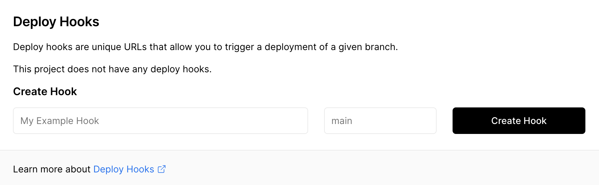
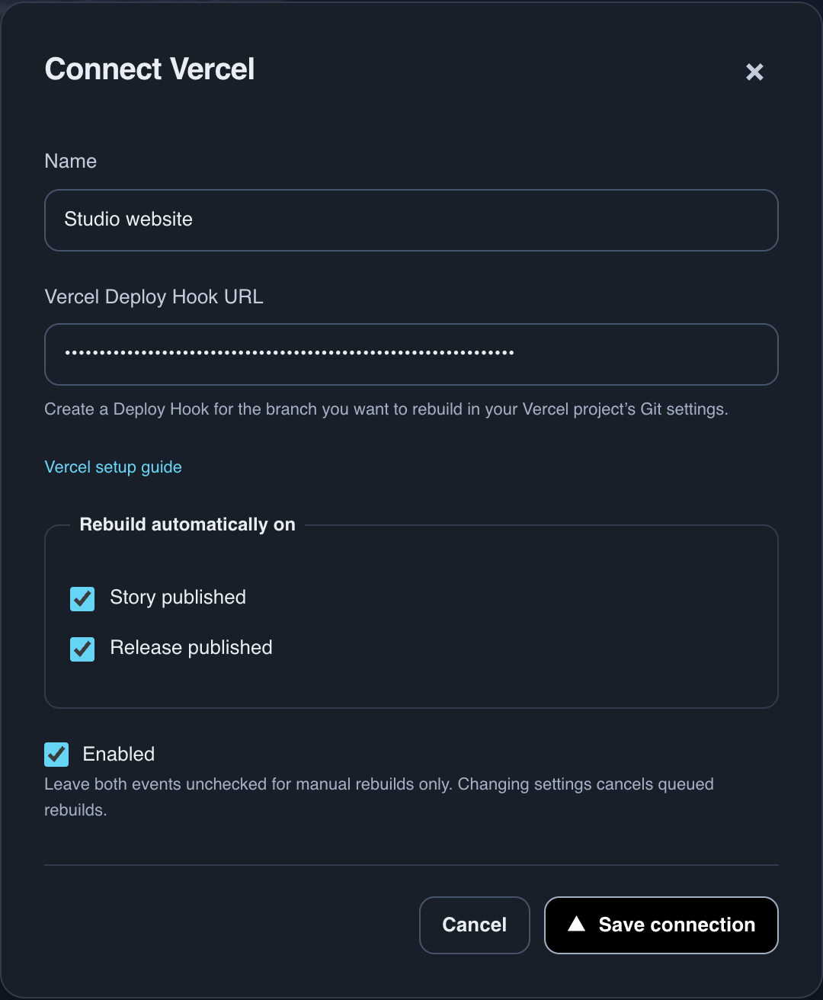
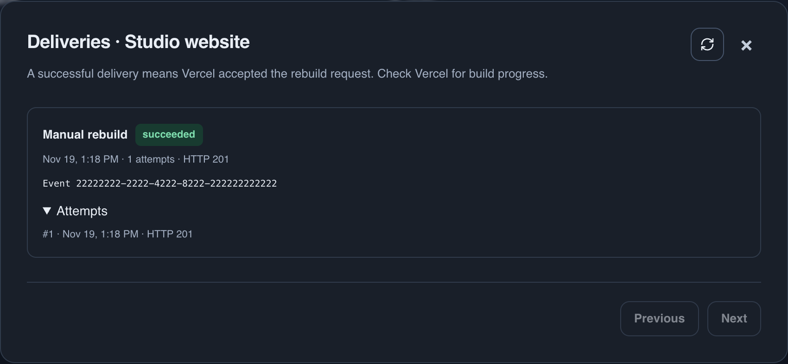

# Rebuild a Vercel site from Storypane

Connect a Git-backed Vercel project to a Storypane space to rebuild your site
after a story publishes or a content release goes live. Your site's build uses
its existing Storypane delivery configuration. You need permission to manage the
Vercel project's Git settings and admin access to the Storypane space.

## 1. Create a Deploy Hook in Vercel

Open your Vercel project and go to **Settings → Git → Deploy Hooks**. Name the
hook **Storypane**, enter the branch that should rebuild, and click **Create
Hook**. For a live site, use the project's production branch, which is often
`main`. Once Vercel creates the hook, copy its URL and keep it private.
[Vercel Deploy Hooks documentation](https://vercel.com/docs/deploy-hooks#creating-a-deploy-hook)

_Screenshot from Vercel's Deploy Hooks documentation._

## 2. Connect the hook in Storypane

Open the Storypane space your website reads from. Go to **Settings → Webhooks**
and choose **Connect Vercel**. Enter a name for the connection and paste the
generated URL into **Vercel Deploy Hook URL**.

Leave **Story published** and **Release published** selected to rebuild
automatically on both events. A multi-page release queues one rebuild after all
its pages publish. Clear both checkboxes for manual rebuilds only. Click
**Save connection**.

## 3. Run a test rebuild

Click **Rebuild now** on the connection. In **Delivery logs**, use the refresh
button beside the close button to check the request. Delivery usually starts
within a minute. A green **succeeded** tag means Vercel accepted the request.
Open **Deployments** in Vercel to follow the build and check the live site when
it finishes.

If a delivery shows a red **failed** tag, expand **Attempts** for the HTTP status.
If you replaced the hook in Vercel, use **Edit** on the connection to enter its
new URL, then choose **Retry delivery**. If Vercel accepted the request and the
build later failed, open that deployment's build logs in Vercel.
